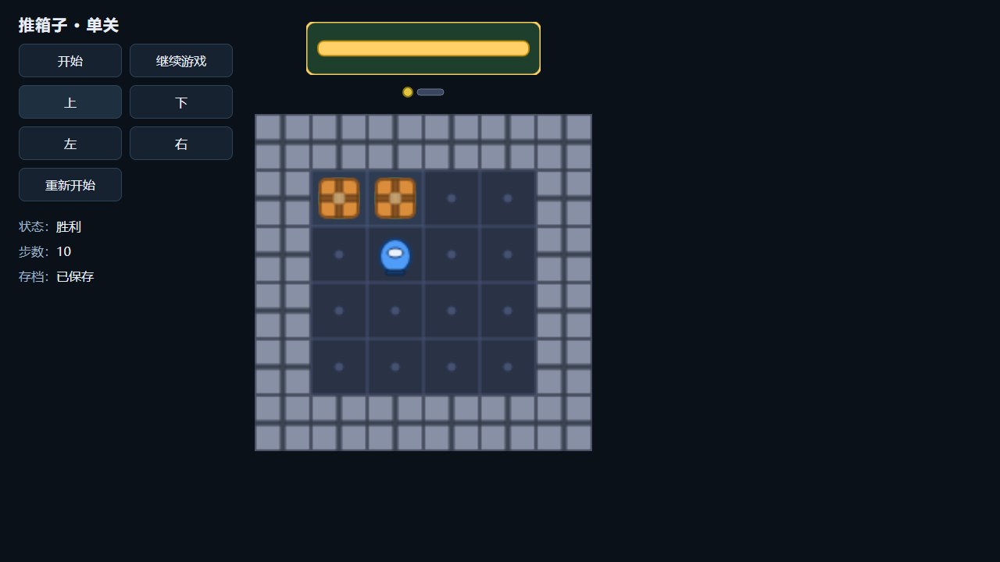

# 封存 C14 候选：独立玩法诊断通过

记录日期：2026-10-15。已审源码 `e634119fd92f67aff3d665d40f08f3154041206c` 对原 C14 候选的逐字节一致 TEMP 副本执行了一次独立诊断，**8段、220步全部通过，0失败、0跳过**。`c14_diagnostic_reviewer` 已独立核查报告、保存重开、退出及文件保持证据；[公开结果](https://github.com/lrfluobida/Cosmos/issues/17#issuecomment-6181057183)已由 Root 发布并精确读回。

这是运行时生成的推箱子迁移游戏，生成时源码仍为 `b20e9a43f26712a1f5a13468057df46b6c012b69`。原游戏代码、构建输出及候选未修改，也未重新编译或发送新模型请求。[原 C14](2026-10-15-transfer-c14-browser-launch.md)保持 failed／已消费。

## 本次实测

| 项目 | 记录 |
| --- | --- |
| 诊断 ID | `c14-diagnostic-838d5054-3ed6-4fc7-baef-656767d215f7` |
| 开始／结束（2026-10-14 UTC） | 23:44:19.845／23:45:00.672 |
| 用时 | 40,827毫秒，即40.827秒 |
| 原计划 | T16-01～06、全部原步骤及存档重开 checkpoint 保留 |
| 正常输入／断言 | 46次点击／174项断言 |
| 各段通过步数 | start 21、walk-wall 26、push 26、box-wall 32、double-box 23、restart 29、restore 26、victory 37 |
| 浏览器 | 7个专用 profile、8个不同进程；均 exit 0，无强制终止 |
| 存档重开 | 同 profile、同 origin，PID 3068 → 12336；保存、恢复值和 checkpoint 一致 |
| 清理后核 | 诊断 Node exit 0、静态服务关闭；端口54331无监听，专用 profile 进程不存在 |
| 原文件保持 | 14处范围的197个文件（含账本）hash／大小／mtime均未改变 |
| 副本／harness | 候选105文件、1,865,138字节及26个 harness 文件均保持一致 |
| 新请求／新费用 | 0／¥0；原账本仍 revision3114，共享累计16,901,000微元（¥16.901000） |

图：本次 victory 段的原始 `final.png`，逐字节复制；界面显示“胜利”、10步和“已保存”。它展示推箱子迁移游戏的局部玩法证据，完整类《植物大战僵尸》目标仍待验证。

## 结论边界

- 本次为 gameplay-only 诊断。媒体62字段、渲染性能、独立 coding 批准、accepted 提升及最终用户体验均未执行；COS16/COS18仍未整体通过，COS91/COS92保持各自源码范围关闭。
- 纯浏览器 harness 省略原运行的 `ownedChild`／controller 路径。40.827秒是本次诊断总时长，不能证明真实 nativeIO 多层准备链能在原15秒启动界限内完成，也不补造原 C14 的历史 spawn／退出证据。
- Root 在独立后核通过后解除本次 main 冻结。原 C14 失败报告、费用及 closure20 历史保持，没有重开原案例或新增生成运行。

## 证据保存

本地私有证据前缀为 `E:/develop/Cosmos/.cosmos/reconciliation/2026-10-13-c6-provider-usage/`：

- `case14-independent-gameplay-preserved/`：原 TEMP 目录的完整副本，334文件、13,618,867字节；原目录为 `C:/Users/26557/AppData/Local/Temp/cosmos-c14-independent-IYR0Ut`。
- `case14-independent-gameplay-preservation.json`：sourceTemp → preservedRoot 对应关系及逐文件 SHA-256 清单，334文件的源／副本 hash 与大小全部一致。副本和清单均在 Git 忽略目录，未改写原报告内部路径。
- 副本根下的 `diagnostic-summary.json` 保存时间、计数、来源及清理摘要；`evidence/` 下的 persistent `report.json` 保存汇总和 checkpoint，各段 `report.json`、截图及视频保存原始结果。浏览器 profile 保持在原报告记载的独立 TEMP 位置，不在这份目录副本中。
- 本次唯一执行脚本 SHA-256：`0d6cc0a9acbfb8bea2cc1b611a87cace40d4aa315fe0459461251fa13488209f`。原意图／脚本及公开结果正文在同一私有证据前缀；未提交会话、凭据或模型推理。
