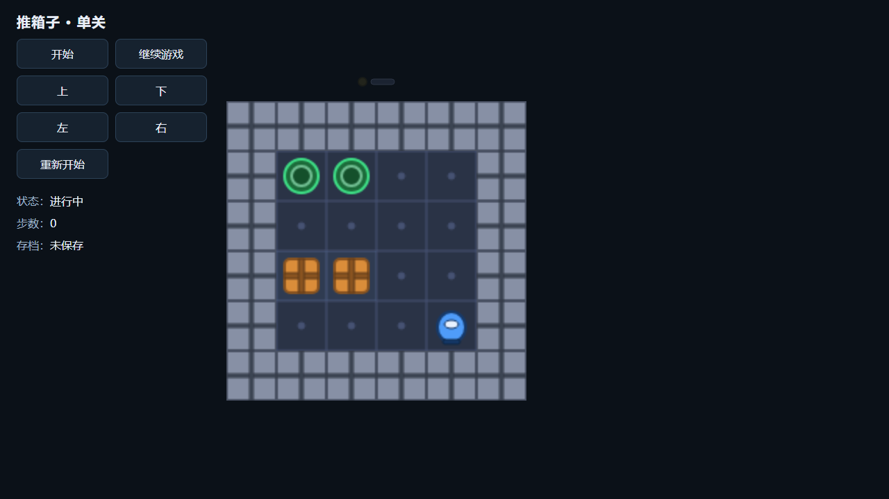

# COS93 navigation-v2：新契约诊断通过

冻结主线 `cd8b4b9fe2ee5e2a72ed976b16ca52d58ee70aad`、组合源码 `5bc4bb6087ff33fc90f3e91e7184eaeb8e603507` 上完成一次真实免费诊断。UTC 2026-10-16 04:42:48—04:57:26（本地12:42—12:57），总计877848ms，Node exit0，外guard未触发、未请求外层kill。result为diagnostic_completed，**`native-validation-waits/2` navigation=passed**。[公开结果与独立后核](https://github.com/lrfluobida/Cosmos/issues/94#issuecomment-6208523921)由Root发布并精确读回。

## 实际测量

| 阶段 | 耗时ms | 结果 |
| --- | ---: | --- |
| prepare_authority | 23131.7075 | passed |
| register_authority | 23896.1538 | passed |
| browser_transport | 69.2852 | passed |
| whole open | 47912.8648 | returned，旧15000ms仍超界 |
| goto(load) | 840.4206 | returned |
| engine ready | 203.6588 | 真实只读观察通过 |
| navigation | 1044.6055 | passed |
| 正常cleanup | 493 | video_stop152、lifecycle_close253；force skipped |

29个HTTP全部完成pre/body/post，0 rejected、0 pending；pre/post最大21.9607/22.7058ms。17260 raw reads全部settled，segment closed、firstCause=null。Observer 4402 spans/5509 events，0 dropped、incomplete=false。浏览器PID32140具有匹配的CDP/profile身份，closeEvent/exitConfirmed=true、exit0、forced=false；`/2` cleanup proof与durable aggregate/segment一致。

图注：迁移验证小游戏的零输入启动画面。PNG原样复制自本次final.png；菜单、玩家、箱子和目标素材已显示，画面为0步。图片SHA-256为 `2d61cff3c5ab4c133266c6a95c16a24295016d669e375d8e6a8ec971755404be`。

WebM为75497B、VP8、1280×720、2.80秒。独立reviewer已用本机FFmpeg完整解码70帧至内存管道并退出0；本次文档复用该证据，不重复解码。

## 保全与结论范围

`cos93_navigation_reviewer` 于UTC05:01:38完成POSTCHECK_NO_LIVE_RESIDUE：原467文件/61目录的SHA-256、大小、纳秒mtime及目录清单全零变；2739条tracked spawn均有close，7个当前同号PID为原close后新建复用。相关进程、三个端口及owner/recovery锁无残留，profile与.owner保留。Root据此解冻main。

真实ledger SHA `e8a921e618da619eacdd439c3260d2edcc10f48edcb823fd716274531cd85632`、16635066B，revision3114/715请求/16901000µ、reserved/unknown0保持。新增provider请求0、费用0；原¥150验证总额与正式¥200/12h硬上限保持。

首段21步全部skipped，原8段/220步计划保持。唯一 `DiagnosticNavigationComplete` 证明到达预定零输入停止点；**production host/game raw仍为failed、reportValid:false**，这是该诊断停止方式的预期结果。独立导航通过来自真实source、停止身份、raw与清理proof核验。原whole-open15失败、navigation-v1失败、C14 failed/consumed、coding review/accepted/human及完整经典验收均不提升。

按[COS93卡“验收与产物”](../specs/cos93-native-startup-diagnostic.md#验收与产物)，本卡诊断完成要求测量结论、原始产物、原文件保全及真实退出/清理证据；卡中明确“诊断完成只表示该免费fixture的结论已查明”。源码已审，本次完整测量与新契约独立诊断通过、正常清理及独立后核齐备，因此建议 **source+diagnostic scoped complete，待本结果文档独审、合入后由Root关闭GitHub #94**。旧15秒独立startup=passed的条件仍未满足，其失败保留为已测结论，不影响测量任务范围的完成判断。

## 证据位置

原始根：`C:/Users/26557/AppData/Local/Temp/cos93-native-startup-navigation-rOaJbe`，含result/trace/progress/before/final。首段raw、browser.log、final.png、browser.webm位于其 `repository/.cosmos/e2e/cos20-transfer-validation-14/browser-evidence/cos16-transfer/cos20-transfer-validation-14-game/v1/validation-2026-10-01/cos20-transfer-validation-14-transfer-v1-start/`。

私有 `.cosmos/reconciliation/2026-10-13-c6-provider-usage/` 保留 `cos93-navigation-v2-actual-result.md`、`cos93-native-navigation-launch-v2-result.json`、`cos93-navigation-v2-actual-preservation.json`。选择归档 `cos93-navigation-v2-actual-preserved` 为654文件/295目录/64447556B，源/目标hash一致且复制期间源未变；它不代替原文件完整保全。launcher SHA-256为 `68fec775f767589173ca030a99cc760814b6dfd341f4ea787e5372a9eb4629b1`，已消费，不重复本次导航。

本提交仅文档与原样PNG，不运行诊断、测试、provider或完整保全检查；下一coding/review案例由独立设计任务承接。
